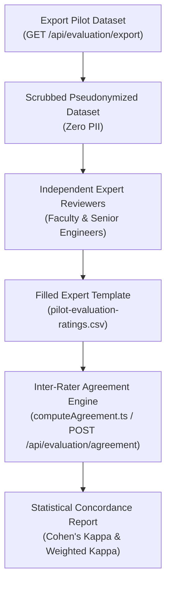

# SkillProof Pilot Evaluation Protocol & Expert Reviewer Guide

This document outlines the standard evaluation protocol, rubric guidelines, and statistical concordance methodology for conducting empirical pilot studies with academic faculty, senior software engineers, and hiring managers (Master Prompt Section 18 / Requirement **R26**).

---

## 1. Study Objective

The primary objective of the pilot evaluation is to measure **concordance** between SkillProof's automated, deterministic evidence-based verification engine and independent expert human judgments across the **Eight Canonical Java & Spring Boot Capabilities**.

The empirical evaluation tests the hypothesis:
$$\mathcal{H}_1: \text{SkillProof automated levels demonstrate substantial agreement } (\kappa_w \ge 0.61) \text{ with blind expert consensus ratings.}$$

---

## 2. Reviewer Protocol & Anonymization

1. **Blind Review**:
   - Evaluators assess candidates strictly through pseudonymized identifiers (`SUBJ_<8hex>`).
   - All personally identifiable information (PII) — including GitHub usernames, developer names, email addresses, personal website URLs, and IP addresses — is scrubbed.
2. **Independent Ratings**:
   - Each evaluator reviews candidate source code artifacts and assessment traces independently without seeing platform-assigned levels or other reviewers' ratings.
3. **Data Recording**:
   - Evaluators record ratings using the standardized tabular format provided in [`docs/pilot-evaluation-template.csv`](./pilot-evaluation-template.csv).

---

## 3. Four-Level Capability Rating Rubric

Evaluators assign one of five progressive levels (`NONE`, `CLAIMED`, `OBSERVED`, `SUPPORTED`, `VERIFIED`) for each candidate on each skill according to this standardized rubric:

| Level | Evaluator Definition | Required Evidence Standard |
|---|---|---|
| **NONE** | No Evidence / Unclaimed | The candidate has not declared the skill and no qualifying evidence exists in the examined codebase. |
| **CLAIMED** | Declared Self-Report | The candidate explicitly claims competence in this capability, but independent code evidence has not yet been verified or confirmed. |
| **OBSERVED** | Confirmed Code Evidence | The candidate has authored confirmed, non-forked, non-tutorial code utilizing canonical patterns (e.g., `@RestController`, `@Entity`, `@Transactional`). Line attribution must be confirmed to the candidate ($> 50\%$). |
| **SUPPORTED** | Knowledge Validation | In addition to static code evidence, the candidate demonstrated applied architectural and diagnostic knowledge by passing scenario-based assessment questions ($\ge 66\%$ threshold). |
| **VERIFIED** | Practical Proof | In addition to static evidence and assessment, the candidate successfully implemented a functional, isolated practical challenge passing rigorous, automated hidden test suites without regressions. |

> [!NOTE]
> Per Rule R11, `unit-tests-meaningful-assertions` is capped at **`SUPPORTED`** because automated grading cannot safely evaluate test suite quality without recursive infinite evaluation.

---

## 4. Evaluation Workflow



### Step 1: Export Pseudonymized Dataset
```bash
# Via CLI:
export PATH="/home/galaxy/Documents/SKILLPROOF/.tools/bin:$PATH"
npx tsx src/scripts/exportPilotData.ts pilot-dataset.json

# Or via API:
curl -H "Cookie: SKILLPROOF_SESSION=<admin_token>" \
     http://localhost:5000/api/evaluation/export > pilot-dataset.json
```

### Step 2: Expert Reviewers Score Candidates
Evaluators inspect candidate commit histories and problem solutions, filling in `pilot-evaluation-ratings.csv` according to the template.

### Step 3: Run Agreement Concordance Engine
```bash
# Via CLI:
npx tsx src/scripts/computeAgreement.ts pilot-evaluation-ratings.csv

# Or via API:
curl -X POST http://localhost:5000/api/evaluation/agreement \
     -H "Content-Type: application/json" \
     -H "X-SkillProof-Request: true" \
     -H "Cookie: SKILLPROOF_SESSION=<admin_token>" \
     -d '{"ratings": [...]}'
```

---

## 5. Statistical Concordance Metrics

The engine calculates three complementary metrics:

### 1. Exact Percentage Agreement ($P_o$)
$$P_o = \frac{\sum_{i=0}^4 M_{ii}}{N}$$
Measures the proportion of skill evaluations where the automated level and expert rating match identically.

### 2. Unweighted Cohen's Kappa ($\kappa$)
$$\kappa = \frac{P_o - P_e}{1 - P_e}$$
Measures agreement adjusted for chance agreement ($P_e$). Interpretation (Landis & Koch, 1977):
- $< 0.20$: Slight agreement
- $0.21 - 0.40$: Fair agreement
- $0.41 - 0.60$: Moderate agreement
- $0.61 - 0.80$: **Substantial agreement** (Target for SkillProof)
- $0.81 - 1.00$: Almost perfect agreement

### 3. Weighted Cohen's Kappa ($\kappa_w$)
Because capability levels are ordinal (`NONE (0)` < `CLAIMED (1)` < `OBSERVED (2)` < `SUPPORTED (3)` < `VERIFIED (4)`), discrepancies between adjacent levels (e.g. `OBSERVED` vs `SUPPORTED`) represent partial agreement, whereas discrepancies between distant levels (e.g. `NONE` vs `VERIFIED`) represent complete disagreement.

The engine implements both:
- **Linear Weighted Kappa**: $w_{ij} = 1 - \frac{|i - j|}{k - 1}$
- **Quadratic Weighted Kappa**: $w_{ij} = 1 - \frac{(i - j)^2}{(k - 1)^2}$

---

## 6. Confusion Matrix

A 5x5 confusion matrix is rendered detailing distributions across all capability levels:

| Platform \ Expert | NONE | CLAIMED | OBSERVED | SUPPORTED | VERIFIED |
|---|:---:|:---:|:---:|:---:|:---:|
| **NONE** | $M_{00}$ | $M_{01}$ | $M_{02}$ | $M_{03}$ | $M_{04}$ |
| **CLAIMED** | $M_{10}$ | $M_{11}$ | $M_{12}$ | $M_{13}$ | $M_{14}$ |
| **OBSERVED** | $M_{20}$ | $M_{21}$ | $M_{22}$ | $M_{23}$ | $M_{24}$ |
| **SUPPORTED** | $M_{30}$ | $M_{31}$ | $M_{32}$ | $M_{33}$ | $M_{34}$ |
| **VERIFIED** | $M_{40}$ | $M_{41}$ | $M_{42}$ | $M_{43}$ | $M_{44}$ |

Off-diagonal values illuminate algorithmic conservatism (below diagonal) vs algorithmic over-crediting (above diagonal), providing empirical feedback for tuning detector thresholds.
