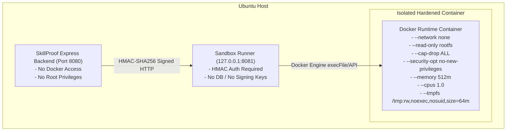

# SkillProof Security Design Document (MERN Edition)

## 1. Threat Modeling & Principles

SkillProof processes untrusted third-party GitHub repositories and user-submitted code. The system architecture enforces a multi-layered defense-in-depth model based on the principle of least privilege.

---

## 2. Threat Analysis & Mitigations Matrix

| Threat Category | Specific Threat | System Mitigation |
|---|---|---|
| **Authentication & Session** | OAuth CSRF / State Fixation | Cryptographically random, single-use `state` token bound to browser session and validated upon callback. |
| **Authentication & Session** | Session Hijacking & XSS | Application JWT issued exclusively via `HttpOnly`, `SameSite=Lax` cookie (`Secure` in production). Inaccessible to client JavaScript. |
| **CSRF** | Cross-Site Request Forgery | Custom header check (`X-SkillProof-Request: true` or `X-CSRF-Token`) enforced on all mutating HTTP methods (`POST`, `PUT`, `DELETE`). |
| **Data Protection** | Stored OAuth Token Leakage | GitHub access tokens encrypted at rest via AES-256-GCM with unique 12-byte IV and auth tag per record. Encryption key loaded exclusively from host environment. Tokens never logged or exposed via API. |
| **Data Isolation** | Insecure Direct Object References (IDOR) | Service-layer ownership verification: every MongoDB query mandates the authenticated `userId` in the filter. |
| **NoSQL Injection** | MongoDB Operator Injection (`$ne`, `$gt`, etc.) | Mongoose schemas set `sanitizeFilter: true`. All incoming request payloads validated against strict Zod schemas that reject objects where strings/numbers are expected. |
| **Prototype Pollution** | Object Prototype Tampering | Deep clone utilities disallow `__proto__`, `constructor`, and `prototype` property assignments. |
| **Repository Ingestion** | Command Injection via Git CLI | Git CLI invoked exclusively using Node.js `child_process.execFile` with argument arrays `['blame', '--porcelain', ...]`. Shell execution (`exec`, `sh -c`) is strictly prohibited. |
| **Repository Ingestion** | Path Traversal & Symlink Attacks | Cloned directories verified within sandbox root. Symbolic links pointing outside the clone workspace are resolved and rejected. Repository file count and size caps enforced. |
| **Repository Ingestion** | Server-Side Request Forgery (SSRF) | Strict regex validation on GitHub repository paths `^[a-zA-Z0-9_.-]+/[a-zA-Z0-9_.-]+$`. Protocol restricted to HTTPS on `github.com`. Arbitrary URLs, `file://`, and private IP ranges blocked. |
| **Sandbox Execution** | Container Escape & Host Takeover | Sandbox runner runs on host as non-root user. Backend has no Docker socket access. Hardened Docker flags: `--network none`, `--read-only`, `--cap-drop ALL`, `--security-opt no-new-privileges`, CPU/memory limits, tmpfs workspace. |
| **Sandbox Execution** | Archive / Zip-Slip Vulnerabilities | Archive uploads prohibited. Code submission restricted to raw string payloads for whitelisted files through authenticated JSON endpoints. |
| **Credential Forgery** | Altered VC Claims | Ed25519 signature computed over canonical RFC 8785 normalized JSON payload. Modifying any character invalidates the cryptographic signature. |
| **Denial of Service** | Resource Exhaustion & Event Loop Lag | `express-rate-limit` on login, analysis dispatch, assessment, and public endpoints. Tree-sitter parsing executed on worker threads / child processes to avoid event loop starvation. |

---

## 3. Sandboxed Execution Hardening

---

## 4. Residual Risks & Transparent Disclosures

Per Section 6.6 and Section 10 of the Master Prompt, the following residual risks are explicitly recognized and documented:
1. **JVM Test Isolation Boundary**: In practical challenges, user-submitted code and hidden JUnit tests execute within the same JVM instance. While hidden tests are compiled separately and editable files are strictly restricted, a sophisticated submission could inspect test class bytecode via reflection. Mitigations include security managers, package filtering, and output sanitization.
2. **Git Commit Spoofing**: Git commit headers (author name and email) are easily forged. SkillProof mitigates this by resolving commit SHAs through GitHub's API to confirm the authenticated GitHub login (`CONFIRMED` status). However, `CONFIRMED` proves only that GitHub attributed the commit to the account, not that the author sat at the keyboard.
3. **Syntax-Level Static Analysis**: Tree-sitter performs syntax-level parsing without JVM classpath resolution. Semantic type disambiguation is approximated via declared type indexing and import resolution.
